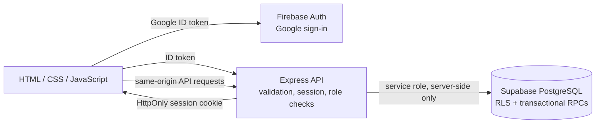
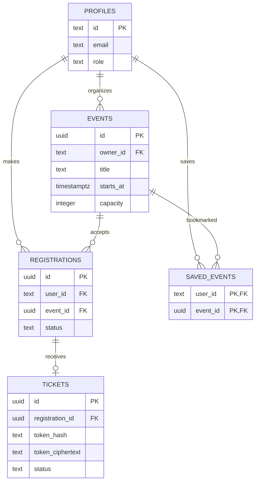

# CampusFlow — Full Stack Project Report

**Project status:** Implementation complete; provider-backed deployment setup pending.
**Stack:** HTML, CSS, vanilla JavaScript, Node.js 22+, Express, Supabase PostgreSQL, Firebase Authentication.
**Source archive:** `../_source_archive/campusflow` is retained unchanged.

## Objective

CampusFlow lets students find campus events, save events, register for seats, and view QR tickets. Organizers can publish and edit their events, see attendees, export a CSV, and scan tickets at the door.

## Features

| Area | Implementation |
|---|---|
| Discovery | Search, category filters, title/date/seat sorting, event details |
| Accounts | Firebase Google sign-in exchanged for a server-verified HttpOnly session cookie |
| Student actions | Save/unsave, capacity-protected registration, cancellation, ticket list and QR |
| Organizer tools | Server-assigned role, event CRUD, analytics, attendee list and CSV export |
| Check-in | QR camera scanner and manual ticket code entry; database-atomic check-in |
| Security | Zod validation, origin and CSRF checks, rate limits, Helmet, ownership checks, RLS, encrypted ticket tokens |
| Accessibility | Semantic landmarks, labeled controls, keyboard skip link, responsive CSS, tested home page with axe |

## Architecture

## Data model

PostgreSQL functions lock the event row when reserving seats, enforce organizer ownership when modifying events, and lock tickets during check-in. Browser roles receive no direct application-table grants; the server uses the Supabase service-role key.

## Local setup

1. Install Node.js 22 or newer and run `npm install`.
2. Copy `.env.example` to `.env` and configure provider values privately.
3. Apply `supabase/migrations/202610270001_core_schema.sql` through the Supabase CLI or SQL editor.
4. Enable Firebase Google sign-in and add local/production domains to its authorized domains.
5. Start `npm start`, then open `APP_URL`. For a provider-free interface preview, use `npm run preview`.
6. Use `npm test` for API/unit tests and `npm run test:e2e` for browser checks.

See the main README for detailed provider and deployment setup. Never commit `.env` or expose service-role, Firebase Admin, or ticket encryption keys.

## Verification record

- Node.js 22.18.0 (27 October 2026): `npm test` — **16 passed, 0 failed, 0 skipped**, including the read-only Supabase RPC smoke test with the configured project.
- Playwright/Chromium: **3 passed** — honest service status, 320/390/768/1280px reflow, skip link and axe scan.
- Automated axe scan found no WCAG 2 A/AA or 2.1 AA violations on the tested homepage. This is a single-state automated check, not a complete accessibility certification.
- The browser sign-in check opened the Google account popup, and the API config, profile, and event endpoints returned HTTP 200. A Google account was not selected, so full session creation was not exercised. Production registration concurrency, real ticket check-in, camera permissions, and hosted deployment remain unverified.
- Browser screenshots: `screenshots/stage1-homepage.png`, `screenshots/stage1-mobile.png`.

## Team work division (fill in)

| Member | Name / registration number | Suggested ownership | Demonstration |
|---|---|---|---|
| Member 1 | [Fill in] | Frontend discovery, responsive UI, accessibility | Search/filter; save an event |
| Member 2 | [Fill in] | API, database, registration and organizer tools | Register/cancel; organizer event and attendee management |

Replace the suggested split with the actual contribution record and add course/section and repository details before submission. No team names or public repository URL were supplied.

## Constraints and remaining external tasks

There are no production user records to migrate; no database dump or secrets were provided. Create Supabase and Firebase projects, apply the schema, configure `.env`/hosting secrets, test with a dedicated project, and choose a host/domain to deploy. Promote an organizer account using `scripts/promote-organizer.js` after that user has signed in once with Google. Never share secret keys in chat; configure them directly in the local `.env` or hosting secret manager.
